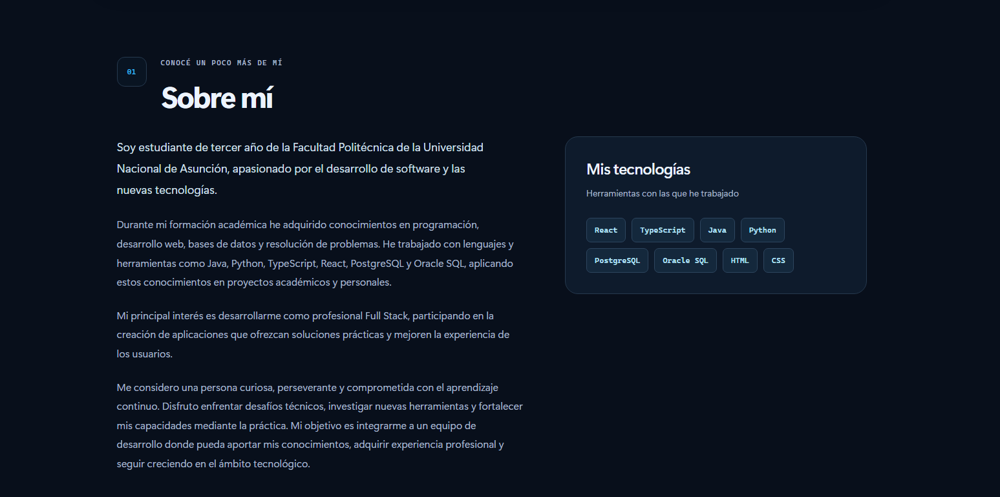

# Osmar Duarte · Portafolio personal

Portafolio académico de marca personal para presentar mi perfil, formación, propuesta de valor y proyectos. Desarrollado con React 19, TypeScript y Vite.

[Ver la web](https://omi12ff.github.io/portafolio/) · [Repositorio](https://github.com/omi12ff/portafolio)



## Contenido

- Presentación y perfil profesional.
- Propuesta de valor y tres atributos con ejemplos.
- Formación académica y experiencia práctica.
- Proyectos con objetivo, participación, resultado y evidencias.
- Reflexión sobre la construcción de la marca personal.
- Contacto y objetivos profesionales.

El proyecto destacado [Security Center AI](https://github.com/omi12ff/SecurityCenterAI) se presenta como una aplicación en desarrollo local para comprender comprobaciones de equipos Windows. Su ficha enlaza al código y muestra una captura real de la página de inicio.

## Diseño e interacción

El sitio adapta su presentación a escritorio y móvil. Incluye navegación con sección activa, progreso de lectura, menú accesible con teclado y transiciones al desplazarse. Respeta la preferencia de movimiento reducido y conserva el contenido visible cuando las APIs de animación no están disponibles.

La fotografía y los materiales del perfil forman parte de la presentación personal de Osmar Duarte.

## Ejecutar localmente

Requisitos: Node.js 24, npm y Git. Los siguientes comandos funcionan desde PowerShell, una terminal de Windows o una terminal compatible:

```sh
git clone https://github.com/omi12ff/portafolio.git
cd portafolio
npm ci
npm run dev
```

Abrí la dirección que indique Vite en la terminal.

## Comandos

| Comando | Uso |
| --- | --- |
| `npm ci` | Instalar las versiones fijadas en el archivo de dependencias. |
| `npm run dev` | Iniciar el servidor de desarrollo. |
| `npm run lint` | Revisar el código con ESLint. |
| `npm run build` | Comprobar TypeScript y generar la versión estática en `dist/`. |
| `npm run preview` | Revisar localmente una compilación ya generada. |

Para revisar la versión de producción:

```sh
npm run lint
npm run build
npm run preview
```

## Publicación

GitHub Actions comprueba el código, genera la versión estática y la publica en GitHub Pages al actualizar la rama `main`. La configuración de Vite utiliza la base `/portafolio/` para que los recursos funcionen en la dirección del sitio.

El despliegue utiliza los archivos generados en `dist/`; las dependencias instaladas y las compilaciones locales no forman parte del repositorio.
